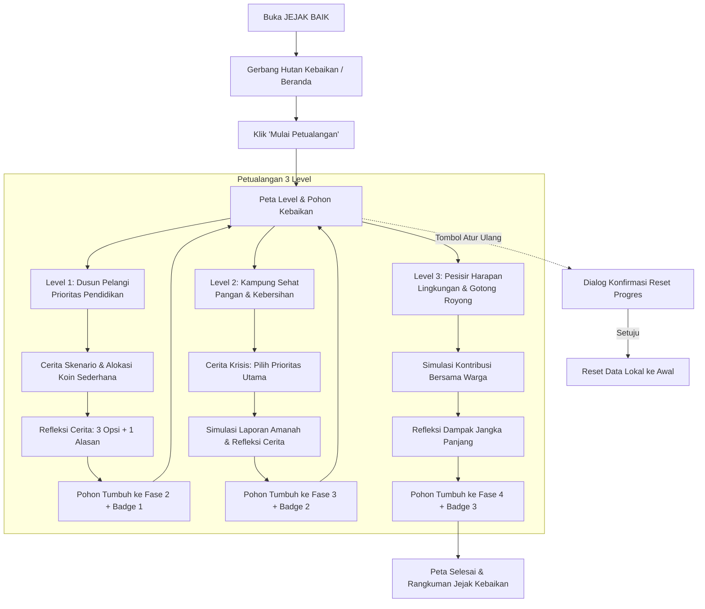

# Product Requirements Document (PRD): JEJAK BAIK

**Nama Produk:** JEJAK BAIK  
**Versi Dokumen:** 1.1.0-MVP  
**Status:** Draf Acuan Pengembangan MVP (Telah Diperbarui Sesuai Keputusan Final)  
**Peran:** Senior Product Manager  
**Tanggal Pembaruan:** 14 Oktober 2026  

---

## 1. Ringkasan Eksekutif & Latar Belakang Masalah

### 1.1 Ringkasan Produk
JEJAK BAIK adalah aplikasi web simulasi petualangan interaktif (*gamified learning adventure*) yang dirancang khusus untuk mengenalkan dasar-dasar literasi keuangan sosial syariah (khususnya nilai sedekah, prioritas kebutuhan, amanah, dan gotong royong) kepada anak usia **8–10 tahun**.

Melalui metafora visual **"Pohon Kebaikan"** bergaya petualangan buku cerita (*whimsical storybook adventure*), anak diajak menyelesaikan tiga skenario misi sosial fiktif. Seluruh aktivitas menggunakan **koin kebaikan virtual** dan **simulasi cerita**. Kenaikan level dan pertumbuhan pohon ditentukan sepenuhnya oleh **kompetensi penalaran moral dan pemahaman anak**, bukan oleh besarnya nominal koin yang disalurkan.

> **PENTING TENTANG SIFAT SIMULASI:**  
> Seluruh skenario, koin, target, dan laporan dampak di dalam platform ini adalah **simulasi cerita edukatif virtual**. Aplikasi ini **tidak** memfasilitasi, mengumpulkan, atau mengklaim penyaluran donasi uang/barang nyata ke dunia nyata.

### 1.2 Latar Belakang Masalah
1. **Abstraksi Konsep Keuangan Sosial:** Pembelajaran sedekah pada anak usia 8–10 tahun kerap terbatas pada imbauan menghafal tanpa memahami alur nilai: mengapa bantuan dibutuhkan, bagaimana memilih kebutuhan yang paling mendesak, dan apa arti menjaga amanah.
2. **Ketiadaan Media Simulasi Bebas Risiko:** Belum banyak media digital interaktif berbahasa Indonesia yang memberikan ruang aman bagi anak untuk berlatih mengambil keputusan alokasi sosial secara mandiri.
3. **Distorsi Gamifikasi Konvensional:** Banyak aplikasi edukasi mengadopsi mekanisme kompetisi (*leaderboard* nominal terbanyak). Hal ini bertentangan dengan esensi keikhlasan dan nilai empati dalam keuangan syariah.

---

## 2. Hipotesis Masalah yang Perlu Divalidasi

Berikut adalah hipotesis awal yang **belum divalidasi melalui pengujian langsung bersama anak dan guru** dan menjadi agenda riset pada sesi uji coba:

* **Hipotesis H1 (Pemahaman Istilah Simulasi Sederhana):** Anak usia 8–10 tahun dapat memahami alur transparansi dana jika istilah disederhanakan menjadi bahasa cerita (misal: *Target Kebaikan*, *Bantuanmu*, *Kebaikan Warga*, dan *Laporan Cerita Tersampaikan*), tanpa bingung dengan konsep akuntansi.
* **Hipotesis H2 (Pemisahan Jelas Dunia Virtual vs Nyata):** Penggunaan label visual "Simulasi Cerita" yang konsisten dapat mencegah kesalahpahaman anak bahwa mereka sedang mengirimkan barang nyata ke luar aplikasi.
* **Hipotesis H3 (Efektivitas Refleksi Cerita Dua Tahap):** Kombinasi tiga pilihan jawaban naratif ditambah satu pertanyaan alasan sederhana cukup menguji pemahaman anak tanpa membuat mereka jenuh atau merasa sedang "dites ujian sekolah".
* **Hipotesis H4 (Rentang Durasi Total 10–15 Menit):** Total durasi keseluruhan 3 level (sekitar 3–5 menit per level, total 10–15 menit) cocok dengan rentang perhatian anak usia 8–10 tahun pada peranti layar sentuh maupun komputer desktop.

---

## 3. Tujuan Pembelajaran (Learning Objectives) yang Spesifik & Terukur

| Kode LO | Tujuan Pembelajaran | Indikator Ketercapaian Terukur |
| :--- | :--- | :--- |
| **LO-1** | Mengenali prioritas kebutuhan mendesak vs pelengkap. | Anak mampu memilih objek bantuan dengan urgensi paling genting berdasarkan narasi cerita di Level 1 dan Level 2. |
| **LO-2** | Memahami prinsip amanah & pelaporan cerita. | Anak mampu menjelaskan arti penting memeriksa laporan penyaluran pada pertanyaan refleksi cerita di Level 2. |
| **LO-3** | Memahami kekuatan gotong royong (kontribusi kolektif). | Anak memahami bahwa bantuan virtualnya berpadu dengan kebaikan warga fiktif untuk mencapai target kebaikan bersama di Level 3. |
| **LO-4** | Menunjukkan pertimbangan sosial tanpa pamrih nominal. | Anak menuntaskan alur misi dengan fokus pada pemecahan masalah warga, bukan mengejar sisa koin terbanyak. |

---

## 4. Target Pengguna & Karakteristik Kognitif Anak Usia 8–10 Tahun

### 4.1 Profil Pengguna Utama
* **Usia Target:** 8 hingga 10 tahun (Siswa Kelas 3 – 5 Sekolah Dasar / Madrasah Ibtidaiyah).
* **Karakteristik Kognitif (Operasional Konkret):**
  * Memahami hubungan sebab-akibat sederhana melalui contoh nyata (contoh: "Air bersih mencegah teman sakit perut").
  * Belum siap mencerna perhitungan persentase atau alokasi anggaran multi-variabel yang rumit.
  * Membutuhkan instruksi singkat (maksimal 2 kalimat per instruksi) dan bahasa yang bersahabat.
* **Karakteristik Fisik & Layar Sentuh:**
  * Target interaksi sentuh minimal **44×44 CSS px** (disarankan **48×48 CSS px**) dengan jarak renggang antar tombol.
  * Interaksi utama berupa ketukan sederhana (*tap/click*). Interaksi kompleks seperti *drag-and-drop* dihindari pada MVP untuk meminimalkan friksi motorik.
* **Durasi Sesi:** Total durasi permainan 1 sesi lengkap dirancang antara **10–15 menit**.

### 4.2 Peran Pendamping (Orang Tua & Guru)
* Menjadi fasilitator diskusi refleksi setelah anak menyelesaikan petualangan.
* Tidak memerlukan akun login atau pendataan apa pun.

---

## 5. User Journey Petualangan



---

## 6. Spesifikasi Halaman & Fitur MVP

### 6.1 Layar 1: Gerbang Hutan Kebaikan (Beranda)
* **Tujuan:** Menyambut anak dengan suasana hangat dan memandu memulai tanpa registrasi.
* **Elemen:**
  * Ilustrasi Pohon Kebaikan tersenyum menyapa.
  * Judul utama dan pengantar singkat (1–2 kalimat ramah anak).
  * Tombol utama: `[Mulai Petualangan]`.
  * Tombol aksesibilitas: Sakelar `Gerak Tenang (Reduced Motion)`.
  * Banner Privasi Ringkas: Memberitahukan bahwa game ini aman, tanpa pengumpulan data pribadi, dan berjalan di perangkat ini.

### 6.2 Layar 2: Peta Petualangan & Taman Pohon
* **Tujuan:** Pusat progres anak, melihat kondisi Pohon Kebaikan, dan memilih misi.
* **Elemen:**
  * **Visual Pohon Kebaikan:** Menampilkan tahapan pertumbuhan saat ini (Tunas $\rightarrow$ Ranting $\rightarrow$ Rimbun $\rightarrow$ Paripurna).
  * **Jalur 3 Misi:**
    * *Level 1: Dusun Pelangi* (Pendidikan) — Terbuka di awal.
    * *Level 2: Kampung Sehat* (Pangan & Kebersihan) — Terbuka setelah Level 1 tuntas.
    * *Level 3: Pesisir Harapan* (Lingkungan) — Terbuka setelah Level 2 tuntas.
  * **Koleksi Lencana Kebaikan:** Menampilkan lencana kompetensi yang telah diperoleh.
  * **Fitur Reset Progres (MVP):**
    * Tombol `[Mulai Cerita Dari Awal]` di sudut menu peta level.
    * Menampilkan dialog konfirmasi ramah anak: *"Apakah kamu ingin menumbuhkan pohon dari tunas mungil lagi? Daun dan lencanamu akan mengulang dari awal ya."* Tombol: `[Ya, Ulangi]` dan `[Batal, Tetap Lanjut]`.
  * **Indikator Penyimpanan (Storage Notice):**
    * Jika `localStorage` tidak tersedia (misal *incognito mode* ketat), muncul kartu ramah di bagian bawah: *"Catatan: Saat ini petualangan berjalan di sesi ini saja. Jika peramban ditutup, cerita akan mengulang dari awal ya."*

### 6.3 Layar 3: Arena Misi & Alokasi Kebaikan
* **Tujuan:** Anak membaca cerita masalah warga dan mengambil keputusan bantuan.
* **Perincian Tiap Level:**
  * **Level 1 (Dusun Pelangi - Pendidikan):**
    * *Cerita:* Ruang kelas tergenang air; buku dan tas basah kuyup menjelang ujian.
    * *Interaksi:* Diberikan kantong koin virtual tetap (100 Koin). Anak memilih alokasi sederhana pada 2 objek: Paket Buku Pelajaran (kebutuhan utama mendesak) vs Hiasan Kelas Warna-warni (pelengkap). Tombol tap `+10 / -10` mudah digunakan.
  * **Level 2 (Kampung Sehat - Pangan & Kebersihan):**
    * *Cerita:* Posko warga sedang pulih setelah air meluap. Warga membutuhkan makanan pokok sehat dan sabun/air bersih agar tidak gatal dan diare.
    * *Interaksi:* **Fokus pemilihan prioritas naratif tanpa alokasi anggaran rumit.** Anak membaca situasi dan memilih paket kombinasi pangan sehat & paket kebersihan darurat yang paling dibutuhkan warga saat itu melalui kartu pilihan prioritas.
    * *Pemeriksaan Amanah:* Menampilkan kartu cerita simulasi laporan: *"Pak RT telah menerima paket kebersihan dan membagikannya ke 15 keluarga. Semua tercatat rapi!"*
  * **Level 3 (Pesisir Harapan - Lingkungan & Gotong Royong):**
    * *Cerita:* Pantai desa nelayan terancam abrasi; warga bergotong royong menanam bibit bakau.
    * *Interaksi:* Anak menyalurkan koin virtualnya, dan melihat bilah progres bersama: Koin Anak + Koin Warga Desa berpadu untuk mencapai 100% target simulasi bibit bakau.

### 6.4 Layar 4: Refleksi Cerita Dua Tahap & Kelulusan Level
* **Tujuan:** Menilai kompetensi pemahaman anak secara mendidik tanpa menghakimi.
* **Format Refleksi (Keputusan Final MVP):**
  1. **Bagian A (Pilihan Naratif):** Tiga pilihan jawaban berbasis cerita (tanpa istilah benar/salah yang kaku). Contoh:
     * *Pilihan 1:* "Supaya buku pelajaran cepat kering dan teman bisa belajar lagi." (Tepat)
     * *Pilihan 2:* "Supaya ruang kelas terlihat paling mewah di desa." (Kurang tepat)
     * *Pilihan 3:* "Supaya kita dipuji oleh guru sekolah." (Kurang tepat)
  2. **Bagian B (Alasan Sederhana):** Satu pertanyaan alasan ringan dengan pilihan pemikiran ramah anak: *"Mengapa menurutmu hal itu paling penting?"*
     * *Opsi:* "Karena teman-teman butuh belajar sekarang" / "Karena kebersihan menjaga badan sehat".
* **Umpan Balik Tanpa Hukuman Moral:**
  * Jika anak memilih opsi yang kurang tepat, Pohon Kebaikan memberikan dialog bersahabat: *"Wah, ide menarik! Tapi coba bayangkan, kalau teman tidak punya buku, bagaimana mereka bisa belajar besok? Yuk, coba kita renungkan lagi bersama!"* Anak dapat memilih ulang tanpa pengurangan poin atau hukuman.
* **Penyelesaian Level:**
  * Animasi Pohon Kebaikan bertumbuh.
  * Penganugerahan Lencana Kompetensi.
  * Tombol kembali ke Peta Petualangan.

---

## 7. Model Data Transparansi Dana & Istilah Ramah Anak

### 7.1 Pemetaan Model Internal ke Istilah Anak
Untuk menjaga ketepatan konsep keuangan sosial syariah tanpa membebani anak dengan jargon akuntansi, sistem menggunakan pemetaan istilah berikut:

| Status Model Internal | Istilah Tampilan untuk Anak | Ikon & Metafora Visual | Penjelasan Cerita untuk Anak |
| :--- | :--- | :--- | :--- |
| **Need Target** *(Target Kebutuhan)* | **Kebutuhan Teman** | 🎯 Bendera Harapan | Jumlah bantuan yang dibutuhkan dalam cerita misi saat ini. |
| **Virtual Allocation** *(Alokasi Virtual)* | **Kebaikan Bantuanmu** | 🪙 Koin Virtualmu | Koin cerita yang kamu salurkan pada petualangan ini. |
| **Realized / Collected Fund** *(Dana Terkumpul)* | **Kebaikan Bersama Warga** | 🤝 Tangan Bergandeng | Simulasi koin kamu yang bersatu dengan bantuan warga cerita lainnya. |
| **Verified Aid Delivery** *(Bantuan Terverifikasi)* | **Simulasi Cerita: Bantuan Sampai!** | 📜 Surat Berita Hangat | Cerita laporan bahwa paket bantuan simulasi telah diterima warga dengan amanah. |

> **DISCLAIMER EDUKATIF MUTLAK PADA UI:**  
> Pada panel status dan laporan misi selalu tercantum keterangan lembut:  
> *"Ini adalah simulasi petualangan cerita koin virtual untuk belajar berbagi."*

---

## 8. Aturan Penilaian Kompetensi & Kenaikan Level

### 8.1 Matriks Kenaikan Level Berbasis Kompetensi

| Level | Judul Misi | Pilar Tema | Fokus Kompetensi | Kriteria Kelulusan |
| :---: | :--- | :--- | :--- | :--- |
| **1** | Dusun Pelangi | Pendidikan | **Prioritas Kebutuhan Pokok:** Membedakan kebutuhan mendesak vs pelengkap. | Memilih bantuan kebutuhan pokok belajar + menuntaskan refleksi alasan kebutuhan. |
| **2** | Kampung Sehat | Pangan & Kebersihan | **Prinsip Amanah & Transparansi:** Memahami pentingnya kepastian penyaluran bantuan. | Menentukan prioritas krisis terpadu + memeriksa simulasi laporan amanah + refleksi kejujuran penyaluran. |
| **3** | Pesisir Harapan | Lingkungan | **Dampak Jangka Panjang & Gotong Royong:** Memahami sedekah jariyah dan kerja bersama. | Menuntaskan simulasi bantuan bersama warga + refleksi manfaat berkelanjutan. |

### 8.2 Arsitektur Ekstensi Fase 2 (Level 4 & 5)
Struktur data konfigurasi level dirancang dinamis dalam format berkas modular:
* *Level 4 (Rencana Fase 2):* Desa Berdaya — Sedekah produktif untuk alat usaha mandiri.
* *Level 5 (Rencana Fase 2):* Kota Tanggap — Kesiapsiagaan bencana & keadilan distribusi multi-wilayah.

---

## 9. Sistem Progres, Pohon Kebaikan, & Toleransi Penyimpanan

### 9.1 Tahapan Pertumbuhan Pohon Kebaikan
1. **Fase 1 — Tunas Mungil:** Kondisi awal saat membuka petualangan.
2. **Fase 2 — Ranting Ceria:** Terbuka setelah lulus kompetensi Level 1.
3. **Fase 3 — Pohon Rimbun:** Terbuka setelah lulus kompetensi Level 2.
4. **Fase 4 — Pohon Harmoni Paripurna:** Terbuka setelah lulus kompetensi Level 3.

### 9.2 Koleksi Lencana Kompetensi (Badges)
* **Lencana Pahlawan Belajar (Level 1):** Mengutamakan kebutuhan belajar teman.
* **Lencana Penjaga Amanah (Level 2):** Menjaga kejujuran dan kepastian bantuan sampai tujuan.
* **Lencana Sahabat Alam (Level 3):** Bergotong royong merawat bumi untuk masa depan.

### 9.3 Toleransi Penyimpanan Lokal (Resilient Storage Fallback)
* Sistem mencoba membaca dan menulis ke `localStorage` dengan kunci `jejak_baik_v1`.
* **Jika `localStorage` tersedia:** State progres disimpan persisten antar penyegaran (*refresh*) browser.
* **Jika `localStorage` TIDAK tersedia** (misal diblokir browser, kuota penyimpanan penuh, atau mode penyamaran ketat):
  * Aplikasi **tidak boleh mogok (*no crash*)**.
  * Aplikasi beralih mulus ke **penyimpanan memori sesi (*in-memory React state*)**.
  * Aplikasi menampilkan pita pemberitahuan (*notice bar*) ramah: *"Pemberitahuan: Progres bermainmu aktif untuk sesi ini saja dan akan kembali ke awal jika peramban ditutup."*

---

## 10. Desain Visual, Interaksi Sentuh, & Animasi

### 10.1 Gaya Visual: Whimsical Storybook Adventure
* **Karakter:** Hangat, bersahabat, seperti ilustrasi buku cerita anak berkualitas.
* **Palet Warna Utama:**
  * *Hijau Tunas & Hutan:* `#2D6A4F`, `#52B788`, `#D8F3DC` (keteduhan, alam, dan pertumbuhan).
  * *Kuning Emas Kebaikan:* `#F4A261`, `#E76F51`, `#FFE8D6` (koin virtual, kehangatan berbagi).
  * *Latar Lembut Kertas:* `#FDFBF7`, `#F4EAD4` (nyaman di mata anak, kontras tinggi).
  * *Biru Udara & Air:* `#457B9D`, `#E0F2FE` (kebersihan dan lingkungan).

### 10.2 Ramah Layar Sentuh & Responsivitas
* **Resolusi yang Didukung:** Dari layar ponsel kecil (360×640 px) hingga layar monitor komputer sekolah (1920×1080 px).
* **Ukuran Tombol Interaktif:** Minimal tinggi dan lebar **48×48 px** dengan ruang kosong pemisah yang cukup untuk mencegah ketukan keliru oleh jari anak.
* **Instruksi Singkat:** Maksimal 15–20 kata per teks penjelas.

### 10.3 Spesifikasi Gerakan (Motion) & Reduced Motion
* Menggunakan animasi halus berbasis *Motion for React* (`framer-motion`).
* **Non-Blocking Rule:** Animasi tidak boleh menunda respon tombol pengguna lebih dari 200ms.
* **Dukungan Reduced Motion:**
  * Mendukung pengaturan otomatis OS (`prefers-reduced-motion`).
  * Menyediakan tombol toggle manual di beranda dan navigasi atas.
  * Ketika aktif: Semua efek lonjakan skala dinonaktifkan, digantikan dengan pergantian visual langsung atau *fade* lembut tanpa efek getar.

---

## 11. Batasan Arsitektur Teknologi MVP

```
+--------------------------------------------------------------------------+
|                        ARSITEKTUR CLIENT-SIDE MVP                        |
+--------------------------------------------------------------------------+
|  [React 18 + Vite] SPA Fungsional                                        |
|  ├── Styling: Tailwind CSS (Kustom Token Warna Ramah Anak)              |
|  ├── Animasi: Motion for React (Non-blocking, Reduced Motion Support)   |
|  ├── Ikon: Lucide React                                                  |
|  └── State & Storage Engine:                                             |
|        ├── State Manager: React Context / Hooks                          |
|        └── Storage Handler: LocalStorage + In-Memory Fallback             |
+--------------------------------------------------------------------------+
|  BATASAN MUTLAK MVP (ZERO EXTERNAL DEPENDENCIES):                        |
|  [X] Tanpa Backend Server         [X] Tanpa Database Cloud               |
|  [X] Tanpa Akun / Login / Auth    [X] Tanpa Transaksi / Payment Gateway  |
|  [X] Tanpa API AI Dinamis         [X] Tanpa Skrip Pelacak Pihak Ketiga   |
+--------------------------------------------------------------------------+
```

---

## 12. Prinsip Perlindungan Privasi Anak & Aksesibilitas

### 12.1 Prinsip Perlindungan Privasi Anak (Konteks Indonesia & Minimisasi Data)
* **Ketiadaan Pengumpulan Data (Zero Data Collection):** Aplikasi sama sekali tidak meminta, mengumpulkan, atau memproses nama lengkap, alamat, nomor telepon, suara, atau foto pengguna.
* **Penyelarasan dengan UU Perlindungan Data Pribadi (UU PDP No. 27/2022):** Menjalankan prinsip minimisasi data secara maksimal dengan tidak memproses data pribadi anak dalam bentuk apa pun pada MVP.
* **Bebas Pelacak Pihak Ketiga:** Tanpa pelacak periklanan, tanpa cookie lintas platform, dan tanpa tautan eksternal yang tidak terawasi.

### 12.2 Aksesibilitas (WCAG 2.1 AA)
* Kontras teks terhadap latar belakang minimal 4.5:1.
* Seluruh fungsi dapat dioperasikan menggunakan keyboard (`Tab`, `Enter`, `Space`).
* Label elemen visual terstruktur dengan atribut ARIA ramah pembaca layar (*screen reader*).

---

## 13. Acceptance Criteria (Bisa Diuji Secara Mandiri)

| ID | Fitur / Komponen | Kriteria Pengujian (Given - When - Then) |
| :--- | :--- | :--- |
| **AC-1** | Beranda & Permulaan | **Given** pengguna baru membuka web, **When** halaman selesai dimuat, **Then** judul cerita, maskot Pohon Kebaikan, tombol `Mulai Petualangan`, dan banner privasi ramah anak tampil rapi tanpa galat konsol. |
| **AC-2** | Transisi & Akses Level | **Given** pengguna berada di peta level, **When** pengguna baru masuk, **Then** Level 1 dapat diakses, sedangkan Level 2 dan 3 terkunci dengan tanda visual gembok bersahabat. |
| **AC-3** | Alokasi Level 1 | **Given** anak memainkan Level 1 dengan saldo 100 koin, **When** anak menambah alokasi 10 koin ke Paket Buku, **Then** sisa koin berkurang menjadi 90 dan koin objek bertambah 10 tanpa jeda input. |
| **AC-4** | Pemilihan Level 2 | **Given** anak memainkan Level 2, **When** anak membaca skenario Kampung Sehat, **Then** antarmuka menyajikan pemilihan prioritas krisis terpadu (pangan sehat & kebersihan) tanpa formulir alokasi anggaran yang rumit. |
| **AC-5** | Simulasi Status Dana | **Given** anak melihat ringkasan alokasi, **When** memeriksa status, **Then** 4 status tampil dengan istilah anak yang ramah dan disertai catatan jelas bahwa ini adalah simulasi cerita koin virtual. |
| **AC-6** | Refleksi Cerita Dua Tahap | **Given** anak menyelesaikan alokasi/prioritas misi, **When** masuk ke tahap refleksi, **Then** sistem menampilkan 3 pilihan narasi cerita dan 1 pertanyaan alasan sederhana. |
| **AC-7** | Penanganan Refleksi Kurang Tepat | **Given** anak memilih jawaban refleksi yang belum sesuai, **When** jawaban dipilih, **Then** sistem TIDAK mengurangi skor/koin dan TIDAK memberikan pesan kesalahan moral, melainkan mengajak merenung kembali melalui narasi bersahabat. |
| **AC-8** | Kelulusan & Pohon Tumbuh | **Given** anak menyelesaikan refleksi dengan tepat, **When** konfirmasi ditekan, **Then** Pohon Kebaikan menampilkan animasi tumbuh ke fase berikutnya, lencana kompetensi baru terbuka, dan level berikutnya dapat diakses. |
| **AC-9** | Dialog Konfirmasi Reset | **Given** anak berada di peta level, **When** menekan tombol `Mulai Cerita Dari Awal`, **Then** muncul dialog konfirmasi ramah anak. Jika dikonfirmasi, seluruh level dan status pohon kembali ke Fase 1. |
| **AC-10**| Fallback Penyimpanan | **Given** browser menonaktifkan `localStorage`, **When** game dimainkan, **Then** game tetap berjalan lancar dalam memori sesi dan menampilkan pemberitahuan bahwa progres hanya berlaku untuk sesi saat ini. |
| **AC-11**| Dukungan Reduced Motion | **Given** sakelar `Gerak Tenang` diaktifkan, **When** pengguna berpindah halaman atau membuka lencana, **Then** seluruh animasi gerakan skala dinonaktifkan tanpa merusak tata letak antarmuka. |

---

## 14. Peta Jalan Fitur Ditunda (Fase 2 / Pasca-MVP)

Fitur-fitur berikut **secara eksplisit ditunda ke Fase 2** agar MVP fokus dan tuntas:

1. **Interaksi Drag-and-Drop Stiker Amanah:** Ditunda ke Fase 2 setelah evaluasi kenyamanan motorik anak di layar sentuh ponsel.
2. **Jurnal Cetak (Printable Journal to PDF):** Ditunda ke Fase 2 setelah pengujian kebutuhan dokumentasi bersama guru kelas.
3. **Level 4 (Desa Berdaya) & Level 5 (Kota Tanggap):** Ditunda ke Fase 2 setelah validasi efektivitas 3 level pertama.
4. **Efek Suara Interaktif Naratif:** Ditunda ke Fase 2 untuk menjaga ukuran unduhan web awal seringan mungkin.
5. **Mode Narasi Bersuara (Audio Read-Aloud):** Ditunda ke Fase 2 untuk anak yang membutuhkan asistensi menyimak.

---

## 15. Risiko, Asumsi Belum Tervalidasi, & Pertanyaan Terbuka

### 15.1 Asumsi Kunci yang Belum Divalidasi Melalui Pengujian Bersama Anak dan Guru
* **Asumsi A1:** Anak usia 8 tahun dapat membaca mandiri pertanyaan refleksi dua tahap tanpa bantuan guru dalam rentang waktu yang diharapkan.
* **Asumsi A2:** Karakter Pohon Kebaikan memberikan kepuasan emosional yang setara atau lebih bermakna dibanding lencana skor angka kompetitif.
* **Asumsi A3:** Durasi 10–15 menit untuk 3 level tidak menimbulkan kejenuhan pada sesi pembelajaran kelas.

### 15.2 Matriks Risiko & Mitigasi Sebelum Implementasi
* **Risiko R1 (Salah Paham Sedekah Nyata):** Anak mengira koin virtual telah mendonasikan barang fisik ke luar aplikasi.  
  * *Mitigasi:* Penegasan label cerita "Simulasi Petualangan" di awal dan akhir level.
* **Risiko R2 (Kehilangan Progres Akibat Pembersihan Riwayat Perangkat Sekolah):**  
  * *Mitigasi:* Mekanisme *session fallback* yang transparan dan alur permainan yang relatif ringkas (10–15 menit tuntas dalam 1 kali pertemuan).

### 15.3 Keputusan Terbuka yang Masih Menunggu Uji Coba Lapangan
1. **OQ-1:** Apakah pertanyaan alasan pada refleksi cukup berupa 2 pilihan radio sederhana atau tombol pil (*chip buttons*) yang besar dan mudah ditekan? *(Rekomendasi teknis: Gunakan tombol pil besar berukuran min 48px).*
2. **OQ-2:** Apakah narasi pembuka cerita di setiap level perlu disajikan dalam format kartu buku bertahap (1 kartu per kalimat) atau 1 kartu terpadu pendek?

---
*Dokumen ini diperbarui untuk mencerminkan seluruh arahan produk final dan menjadi acuan tunggal perancangan arsitektur antarmuka JEJAK BAIK.*
