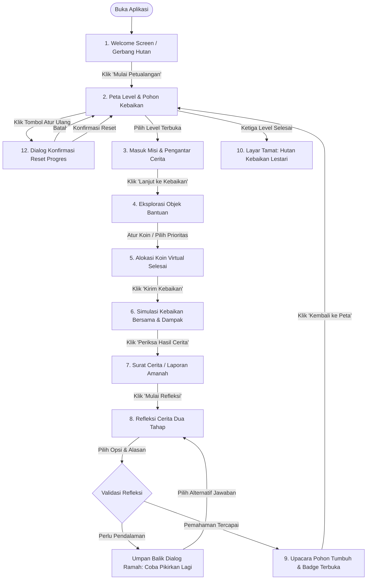

# Dokumen Alur Pengguna (User Flow): JEJAK BAIK

**Nama Produk:** JEJAK BAIK  
**Dokumen Pendamping:** [`PRD.md`](file:///c:/JEJAKTUMBUH/docs/PRD.md) & [`DECISIONS.md`](file:///c:/JEJAKTUMBUH/docs/DECISIONS.md)  
**Versi:** 1.0.0  
**Peran:** Senior UI/UX Designer & Game Designer  
**Tanggal:** 14 Oktober 2026  

---

## 1. Ikhtisar Alur & Prinsip Desain Interaksi

JEJAK BAIK dirancang dengan struktur alur yang terarah (*guided adventure flow*) untuk anak usia **8–10 tahun**. Setiap interaksi diarahkan untuk menumbuhkan pemahaman etika keuangan sosial syariah:
1. **Bebas Tekanan Waktu:** Tidak ada penghitung waktu mundur (*timer*) atau penalti kecepatan klik.
2. **Tanpa Kegagalan Fatal (*No Game Over*):** Kesalahan dalam refleksi tidak membatalkan permainan, melainkan menjadi jembatan dialog edukatif bersama maskot Pohon Kebaikan.
3. **Pemisahan Nyata vs Simulasi:** Di setiap tahapan yang menampilkan data angka dan hasil dampak, dicantumkan label penanda visual **[SIMULASI]** agar anak memahami bahwa aktivitas ini adalah simulasi pembelajaran koin virtual.

---

## 2. Peta Diagram Alur Pengguna Lengkap

---

## 3. Spesifikasi Alur Layar demi Layar

### 3.1 Layar 1: Welcome Screen (Gerbang Hutan Kebaikan)
* **Tujuan:** Menyambut anak dengan ramah, membangun rasa aman, dan memulai petualangan tanpa login atau input data pribadi.
* **Tindakan Pengguna:**
  * Membaca sambutan hangat Pohon Kebaikan.
  * Menekan tombol utama `[Mulai Petualangan]`.
  * Opsional: Menekan sakelar aksesibilitas `[Gerak Tenang / Reduced Motion]`.
* **State yang Berubah:**
  * Inisialisasi status penyimpanan: memeriksa ketersediaan `localStorage`. Jika tidak tersedia, aktifkan bendera `isInMemoryFallback: true`.
  * Mengambil data progres yang tersimpan atau memuat state awal default.
* **Kondisi Perpindahan:**
  * Klik tombol `[Mulai Petualangan]` $\rightarrow$ berpindah ke **Layar 2 (Level Map)** dengan transisi memudar lembut (*gentle cross-fade*).
* **Kemungkinan Mengulang:** Pengguna dapat kembali ke layar ini kapan saja melalui tombol navigasi beranda.

---

### 3.2 Layar 2: Peta Level & Pohon Kebaikan (Main Hub)
* **Tujuan:** Menjadi pusat navigasi visual progres pemain, menampilkan fase pertumbuhan Pohon Kebaikan, dan memilih misi yang tersedia.
* **Tindakan Pengguna:**
  * Melihat kondisi visual Pohon Kebaikan dan koleksi lencana (*badges*).
  * Memilih kartu level yang sedang terbuka.
  * Menekan tombol `[Mulai Cerita Dari Awal]` jika ingin mereset progres.
* **State yang Berubah:**
  * Menentukan level aktif yang dapat diklik (`currentLevelId`).
  * Menampilkan pesan pemberitahuan ramah jika sedang berjalan dalam mode memori sesi (*in-memory fallback*).
* **Kondisi Perpindahan:**
  * Klik Level 1 (selalu terbuka untuk pengguna baru) $\rightarrow$ berpindah ke **Layar 3 (Misi Dusun Pelangi)**.
  * Klik Level 2 atau 3 (hanya dapat diklik jika level sebelumnya telah tuntas).
  * Klik Level terkunci $\rightarrow$ memicu animasi getar lembut kartu dan petunjuk suara visual: *"Selesaikan petualangan sebelumnya dulu ya!"*.
* **Kemungkinan Mengulang:** Anak bebas membuka kembali level yang sudah selesai untuk membaca ulang ceritanya tanpa merusak progres level berikutnya.

---

### 3.3 Layar 3: Masuk Misi & Membaca Cerita Masalah
* **Tujuan:** Menanamkan empati melalui cerita bergambar pendek mengenai masalah konkret yang sedang dialami warga di lokasi misi.
* **Tindakan Pengguna:**
  * Membaca teks cerita pendek (2–3 kalimat sederhana).
  * Melihat ilustrasi situasi warga desa.
  * Menekan tombol `[Bantu Warga Sekarang]`.
* **State yang Berubah:**
  * State misi diatur ke mode alokasi aktif.
  * Saldo virtual "Koin Pilihanmu" diinisialisasi (misal: 100 koin untuk Level 1).
* **Kondisi Perpindahan:**
  * Klik `[Bantu Warga Sekarang]` $\rightarrow$ berpindah ke **Layar 4 (Eksplorasi Objek & Alokasi)**.
* **Kemungkinan Mengulang:** Anak dapat menekan tombol `[Kembali ke Peta]` di sudut atas jika belum ingin melanjutkan misi.

---

### 3.4 Layar 4: Memilih Objek Sedekah & Mengalokasikan Koin Virtual
* **Tujuan:** Melatih pertimbangan rasional-moral dalam memprioritaskan kebutuhan sosial menggunakan koin virtual.
* **Tindakan Pengguna Berdasarkan Level:**
  * **Level 1 (Dusun Pelangi):** Menekan tombol `+10` / `-10` pada 2 kartu objek (Paket Buku vs Hiasan Kelas) hingga seluruh 100 koin teralokasikan.
  * **Level 2 (Kampung Sehat):** Memilih kartu paket prioritas krisis terpadu (Kombinasi Pangan Sehat & Sanitasi Darurat) tanpa pembagian angka rumit.
  * **Level 3 (Pesisir Harapan):** Mengalokasikan koin virtual untuk bibit bakau dan melihat koin bergabung dengan kas bersama warga.
* **State yang Berubah:**
  * Sisa koin di kantong berkurang secara riil di UI.
  * Indikator status internal berubah: `virtualAllocation` diperbarui.
  * Tombol aksi `[Kirim Kebaikan]` menjadi aktif ketika syarat minimal alokasi terpenuhi.
* **Kondisi Perpindahan:**
  * Klik `[Kirim Kebaikan]` $\rightarrow$ berpindah ke **Layar 5 (Simulasi Dampak & Kebaikan Bersama)**.
* **Kemungkinan Mengulang:** Sebelum menekan tombol kirim, anak dapat menambah, mengurangi, atau membatalkan pilihan koin sesuka hati tanpa batas waktu.

---

### 3.5 Layar 5: Melihat Simulasi Dampak & Kebaikan Bersama
* **Tujuan:** Memperlihatkan bahwa bantuan anak melengkapi bantuan warga lain dan menghasilkan dampak nyata di desa fiktif.
* **Tindakan Pengguna:**
  * Mengamati visualisasi batang kemajuan gabungan: **Koin Pilihanmu** + **Kebaikan Bersama Warga** memenuhi **Tujuan Kebaikan**.
  * Melihat label jelas: **[SIMULASI CERITA VIRTUAL]**.
  * Menekan tombol `[Periksa Hasil Cerita]`.
* **State yang Berubah:**
  * Status alur bergerak dari penyaluran ke tahap pelaporan amanah.
* **Kondisi Perpindahan:**
  * Klik `[Periksa Hasil Cerita]` $\rightarrow$ membuka **Layar 6 (Surat Cerita Laporan Amanah)**.

---

### 3.6 Layar 6: Laporan Cerita Amanah (Surat Pak RT / Bukti Cerita)
* **Tujuan:** Menanamkan nilai amanah dan transparansi: bantuan yang dikumpulkan harus dapat dipertanggungjawabkan dan sampai ke tangan yang berhak.
* **Tindakan Pengguna:**
  * Membaca surat cerita bergambar (khususnya di Level 2 dari Pak RT, bertuliskan stempel ceria **[SIMULASI AMANAH TERSAMPAIKAN]**).
  * Membaca ringkasan sederhana bahwa barang bantuan telah dibagikan dengan adil.
  * Menekan tombol `[Lanjut ke Refleksi]`.
* **State yang Berubah:**
  * Verifikasi cerita tercatat aktif di state sesi.
* **Kondisi Perpindahan:**
  * Klik `[Lanjut ke Refleksi]` $\rightarrow$ masuk ke **Layar 7 (Refleksi Cerita Dua Tahap)**.

---

### 3.7 Layar 7: Menjawab Refleksi Cerita (Evaluasi Kompetensi)
* **Tujuan:** Menguji pemahaman esensial (kompetensi) anak melalui dialog situasi yang bersahabat.
* **Tindakan Pengguna:**
  * **Tahap 1:** Memilih satu dari **3 tombol pil besar** yang berisi pertimbangan cerita.
  * **Tahap 2:** Memilih satu dari **2 tombol pil alasan sederhana** (*"Mengapa menurutmu ini paling penting?"*).
  * Menekan tombol `[Selesaikan Misi]`.
* **State yang Berubah:**
  * Jawaban pilihan anak tersimpan dalam state evaluasi misi sementara.
* **Kondisi Perpindahan:**
  * Klik `[Selesaikan Misi]` $\rightarrow$ sistem mengevaluasi kecocokan penalaran anak.

---

### 3.8 Layar 8: Umpan Balik Refleksi & Penanganan Pilihan
* **Tujuan:** Memberikan umpan balik tanpa hukuman moral dan memandu anak berpikir jernih.
* **Tindakan Pengguna:**
  * **Jika pertimbangan tepat:** Anak membaca apresiasi hangat dari Pohon Kebaikan.
  * **Jika pertimbangan kurang sesuai konteks prioritas:** Anak membaca dialog pemantik rasa ingin tahu dari Pohon Kebaikan:
    > *"Wah, ide yang menarik! Tapi coba bayangkan, jika teman-teman belum memiliki buku saat kelas dimulai, bagaimana mereka bisa belajar? Yuk, coba renungkan kembali!"*
  * Anak menekan tombol `[Coba Pilih Lagi]` tanpa penalti koin atau rasa bersalah.
* **State yang Berubah:**
  * Jika tepat $\rightarrow$ `isCompetencyPassed = true`.
* **Kondisi Perpindahan:**
  * Ketika kompetensi terpenuhi $\rightarrow$ langsung memicu **Layar 9 (Upacara Pohon Tumbuh & Badge)**.

---

### 3.9 Layar 9: Upacara Pohon Tumbuh & Pembukaan Lencana (Level Up)
* **Tujuan:** Memberikan penghargaan intrinsik yang menggembirakan atas bertambahnya pemahaman anak.
* **Tindakan Pengguna:**
  * Menyaksikan animasi Pohon Kebaikan bertumbuh (tunas mekar, ranting bertambah daun, atau pohon berbuah).
  * Melihat pembukaan kartu lencana kompetensi baru dengan kilau lembut.
  * Menekan tombol `[Kembali ke Peta Petualangan]`.
* **State yang Berubah:**
  * `completedLevels` bertambah level saat ini.
  * `unlockedLevel` bertambah ke level berikutnya (misal dari Level 1 ke Level 2).
  * `treeStage` meningkat (1 $\rightarrow$ 2 $\rightarrow$ 3 $\rightarrow$ 4).
  * `earnedBadges` menyimpan id lencana baru.
  * Data otomatis diserialkan ke `localStorage` (atau state memori jika storage tidak aktif).
* **Kondisi Perpindahan:**
  * Klik `[Kembali ke Peta Petualangan]` $\rightarrow$ kembali ke **Layar 2** dengan visual pohon yang sudah baru dan level berikutnya menyala terang.

---

### 3.10 Layar 10: Layar Tamat (Hutan Kebaikan Lestari)
* **Tujuan:** Memberikan rasa pencapaian paripurna setelah menyelesaikan ketiga level MVP.
* **Tindakan Pengguna:**
  * Melihat Pohon Kebaikan Paripurna (Fase 4) yang rindang dan dihuni satwa sahabat.
  * Melihat ketiga lencana kompetensi yang telah diraih secara utuh.
  * Membaca pesan penutup mengenai pentingnya terus menjaga nilai amanah dan suka berbagi di kehidupan nyata bersama keluarga dan teman.
  * Opsi: Menekan tombol `[Ulangi Petualangan Kapan Saja]`.

---

### 3.11 Layar 11: Dialog Konfirmasi Reset Progres
* **Tujuan:** Menjamin anak atau guru dapat mengulang permainan dari nol dengan aman tanpa kecelakaan hapus data.
* **Tindakan Pengguna:**
  * Membaca pertanyaan konfirmasi ramah anak di dalam modal dialog.
  * Menekan tombol `[Batal, Tetap Lanjut]` jika tidak sengaja menekan.
  * Menekan tombol `[Ya, Ulangi dari Tunas]` untuk mereset.
* **State yang Berubah:**
  * Jika dikonfirmasi: `localStorage` dihapus/direset ke konfigurasi awal (Level 1 terbuka, Tree Stage 1, Badges kosong).
* **Kondisi Perpindahan:**
  * Modal tertutup dan antarmuka Peta Level langsung merender ulang Pohon Kebaikan pada Fase Tunas Mungil.

---

## 4. Penjelasan Spesifik 3 Level MVP & Jenjang Kesulitan

Tingkat kesulitan diatur meningkat secara bertahap dari sisi **kedalaman pertimbangan**, bukan kerumitan matematika:

| Level & Lokasi | Tema & Pilar | Tingkat Kesulitan | Skenario & Masalah | Pilihan Kebaikan & Alokasi | Refleksi & Penilaian Kompetensi |
| :--- | :--- | :--- | :--- | :--- | :--- |
| **Level 1: Dusun Pelangi** | **Pendidikan** | **Pengenalan Dasar (Beginner):** Membedakan kebutuhan primer vs sekunder. | Kelas sekolah desa kemasukan air hujan. Buku pelajaran rusak, dan ada usulan membeli hiasan gantung warna-warni. | **Objek A:** Paket Buku & Alat Tulis (Urgensi Tinggi). **Objek B:** Hiasan Kelas Indah (Pelengkap). *Interaksi:* Alokasi 100 koin koin virtual via tombol `+10/-10`. | **Soal Refleksi:** *"Apa yang terjadi jika kita mendahulukan hiasan daripada buku pelajaran?"* **Tiga Pilihan:** 1. Kelas cantik tapi teman tidak bisa ikut belajar (Tepat). 2. Teman senang karena kelas banyak pita (Kurang tepat). 3. Guru memuji hiasan baru (Kurang tepat). **Alasan:** Memilih prioritas belajar teman. |
| **Level 2: Kampung Sehat** | **Pangan & Kebersihan** | **Menengah (Intermediate):** Memilih prioritas terpadu & memeriksa amanah penyaluran. | Warga posko darurat membutuhkan bantuan setelah air surut. Warga butuh makanan sehat dan sabun/air bersih agar tidak terjangkit wabah diare dan gatal-gatal. | **Fokus Pilihan Prioritas Terpadu (Tanpa Anggaran Rumit):** Anak memilih **Paket Sehat Terpadu** (Makanan bergizi & perlengkapan sanitasi air bersih) dibanding paket camilan manis/mainan hiburan. | **Pemeriksaan Amanah:** Membaca Surat Cerita Pak RT [SIMULASI]. **Soal Refleksi:** *"Mengapa laporan pembagian paket dari Pak RT sangat penting diperiksa?"* **Tiga Pilihan:** 1. Memastikan bantuan amanah sampai ke tangan warga yang membutuhkan (Tepat). 2. Agar Pak RT mendapat piala desa (Kurang tepat). 3. Supaya nama kita tercatat di koran (Kurang tepat). **Alasan:** Menjaga kejujuran dan amanah. |
| **Level 3: Pesisir Harapan** | **Lingkungan & Gotong Royong** | **Tinggi (Advanced):** Memahami efek kumulatif bersama dan manfaat jangka panjang (sedekah jariyah). | Ombak laut mulai mengikis pantai tempat perahu nelayan bersandar. Warga berinisiatif menanam hutan bakau dan membersihkan pantai bersama. | **Simulasi Gotong Royong:** Kebutuhan 300 koin. Warga telah mengumpulkan 220 koin. Anak menyalurkan sisa 80 koinnya untuk menuntaskan target bersama. | **Soal Refleksi:** *"Mengapa menanam bibit pohon bakau disebut kebaikan yang terus mengalir?"* **Tiga Pilihan:** 1. Karena pohonnya terus hidup dan melindungi desa hingga masa depan (Tepat). 2. Karena pohon bakau bisa dijual mahal besok pagi (Kurang tepat). 3. Supaya pantai terlihat ramai oleh turis saja (Kurang tepat). **Alasan:** Kebaikan yang awet dinikmati generasi mendatang. |

---

## 5. Pendekatan Non-Dogmatis dalam Penilaian Refleksi

> **PRINSIP DESAIN PENTING:**  
> Kami tidak memaksakan satu jawaban moral sebagai kebenaran mutlak yang kaku jika terdapat argumen anak yang logis dalam konteks tertentu. 

* Pada tahap evaluasi refleksi, sistem mengapresiasi setiap niat baik anak, namun mengarahkan penalaran pada **dampak paling maslahat (prinsip maqashid syariah: perlindungan akal, jiwa, dan lingkungan)**.
* Bahasa umpan balik dirancang netral dan dialogis, menghindari dikotomi "Pahala vs Dosa" atau "Benar vs Salah". Kata kunci yang digunakan adalah: *"Lebih Mendalam"*, *"Mari Kita Pikirkan Dampaknya"*, dan *"Pilihan Bijak"*.

---

## 6. Asumsi Desain Alur yang Perlu Diuji Bersama Anak dan Guru

1. **[ASUMSI BELUM TERVALIDASI] Transisi Dua Tahap Refleksi:**  
   *Perlu diuji apakah anak usia 8 tahun merasa alur dua tahap (Pilihan Cerita lalu Pertanyaan Alasan) terasa cepat dan mengalir, ataukah menimbulkan kesan beban membaca tambahan.*
2. **[ASUMSI BELUM TERVALIDASI] Pemahaman Surat Pak RT di Level 2:**  
   *Perlu diuji apakah format surat ilustratif cukup menjelaskan konsep "amanah dan verifikasi" kepada siswa kelas 3 SD tanpa penjelasan tambahan dari guru.*
3. **[ASUMSI BELUM TERVALIDASI] Keberadaan Tombol Reset di Peta Level:**  
   *Perlu diobservasi apakah penempatan tombol reset di pojok peta aman dari ketukan tidak sengaja saat dimainkan anak di layar ponsel.*
